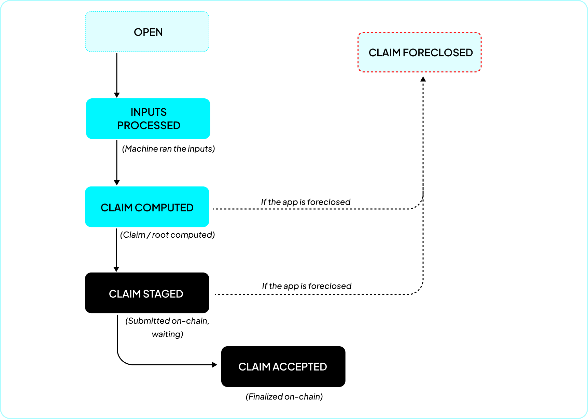

To understand foreclosure, it helps to first see how an application's inputs turn into settled state, and where foreclosure fits in. This page walks through that lifecycle.

## From inputs to a settled claim

**Inputs.** A user action (a deposit through a portal, or a message sent to the app) becomes an **input**, recorded on-chain in the [`InputBox`](../../api-reference/contracts/input-box.md).

**Epochs.** Inputs are not settled one at a time. They are grouped into **epochs**: batches of consecutive inputs that are settled together as a single claim. Every input belongs to exactly one epoch. How epoch boundaries are drawn depends on the consensus; under Authority and Quorum an epoch covers a range of blocks, set by the consensus `epochLength`. Under PRT (Dave), a new epoch is sealed each time the previous epoch's result is accepted, and it holds every input added since the previous epoch was sealed.

**Claims.** The application runs as a deterministic Cartesi Machine. The node feeds each input to the machine as it arrives, advancing the machine's state and producing outputs. When the epoch closes, the node reduces the resulting state to a single fingerprint, a **claim** (a Merkle root), and posts it on-chain so the consensus contract can trust the off-chain computation by verifying one hash.

Under Authority and Quorum, posting a claim happens in **two transactions**:

1. **Submit** (`submitClaim`) posts the claim. The node marks the epoch `CLAIM_SUBMITTED` when it sends the transaction, and `CLAIM_STAGED` once the claim is staged on-chain. Under Authority, submitting the claim stages it; under Quorum, the claim is staged when a majority of the validators has submitted it.
2. **Accept** (`acceptClaim`) finalizes it, once a waiting period has passed. The epoch becomes `CLAIM_ACCEPTED`.

The waiting period between the two is the **claim staging period**, measured in blocks and fixed when the consensus is deployed. The consensus contract enforces it: `acceptClaim` reverts until enough blocks have passed since the claim was staged. A staging period of `0` lets a claim be accepted in the same block in which it is staged.

**Under PRT (Dave),** validators do not vote on a claim: each epoch is settled by a dispute tournament on the `DaveConsensus` contract. Once the tournament has a winner, anyone can call `stageTournamentResult`. It only accepts a winning post-epoch machine state that comes with a proof that the machine finished the epoch ready for the next input (a manual yield with an "rx accepted" reason). `acceptStagedTournamentResult` can then finalize the result once either the claim staging period has passed since staging, or every sentry configured in the consensus has submitted a claim for the same post-epoch state. A sentry node submits the post-epoch state it computed itself, so sentries can shorten the wait only for a result they agree with. A consensus without sentries always waits for the staging period.

## The epoch status flow

An epoch moves through these statuses:

- **OPEN**: the epoch's block range is still current and collecting inputs.
- **CLOSED**: the epoch has closed (its block range ended or, under PRT, it was sealed on-chain), but the machine has not yet processed all of its inputs.
- **INPUTS_PROCESSED**: the epoch has closed and the machine has processed all of its inputs.
- **CLAIM_COMPUTED**: the node has the claim ready.
- **CLAIM_SUBMITTED**: the node has sent the claim transaction and is waiting to see the claim staged on-chain.
- **CLAIM_STAGED**: the claim was submitted on-chain and is in its staging window.
- **CLAIM_ACCEPTED**: the staging period elapsed and the claim was finalized. This is the settled state that outputs (and emergency withdrawal) rely on.
- **CLAIM_FORECLOSED**: a terminal status a claim reaches if the application is foreclosed before that claim finalizes (see below).
- **CLAIM_REJECTED**: this is a related terminal status, but a **node-level** one rather than an on-chain outcome. The node marks its own epoch `CLAIM_REJECTED` (and the application `DIVERGED`) when it observes that a claim different from the one it computed was accepted on-chain, for example on a Quorum where another validator's claim won the vote. 

## Foreclosure

Everything above assumes the operator keeps running the node and the application operates in optimum condition. Foreclosure is what happens when you can no longer depend on that. 

**Foreclosure** is the act of permanently freezing a Cartesi Rollups application at its last accepted state, this process can be triggered in situations where; the operator abandons the application, a bug is discovered in the application code, a compromised authority, a dishonest quorum majority, a false claim is left unchallenged in a PRT dispute tournament, or a PRT epoch cannot be settled at all (see [Epochs that PRT cannot settle](#epochs-that-prt-cannot-settle)). 

The claim staging period is the guardian's window to act: foreclosing before such a claim is accepted terminalizes it as `CLAIM_FORECLOSED` and freezes the application on the last state it still trusts, so users withdraw against that state and not the bad one. It's important to note that, Foreclosure does not reverse a claim that has already been accepted; once a state is accepted it is what emergency withdrawals pay out from, which is why the guardian's protection depends on acting within the staging window.

Choose the staging period with this in mind: it must cover the guardian's reaction time, in blocks, from noticing a bad claim to getting `foreclose()` included on-chain. A staging period of `0` gives the guardian no window at all, because a claim can be staged and accepted in the same block. `cartesi-rollups-cli deploy` uses `0` unless you pass `--claim-staging-period` (see [Deploying with emergency withdrawal](../../deployment/self-hosted/with-emergency-withdrawal.md)). Under PRT, a staged result can also be accepted before the staging period ends once every sentry has submitted a matching claim, so with sentries the guardian's window can be shorter, down to zero blocks.

To foreclose an application, the **guardian**, a single address fixed in the withdrawal config, calls [`foreclose()`](../../api-reference/contracts/application.md#foreclose) on the application contract.  [`isForeclosed()`](../../api-reference/contracts/application.md#isforeclosed) becomes `true` and this permanently freezes the application:

**A foreclosed application can no longer process inputs.** Once frozen it takes on no new inputs (the `InputBox` rejects them) and settles no new state. What remains is returning the assets users already deposited, directly from the contracts:

- [emergency withdrawal](./recovery-guide.md) pays out the balances in the accounts drive of the last settled state;
- [deposit refunds](./recovery-guide.md#step-7-refund-unfinalized-deposits) return portal deposits whose inputs were never finalized, through [`issueRefund()`](../../api-reference/contracts/application.md#issuerefund). Refunds are not automatic: anyone can send them, but someone has to;
- outputs, such as vouchers, of epochs accepted before the foreclosure can still be executed as usual.

Off-chain components that accept transactions on the application's behalf, such as a sequencer, must stop accepting them once the application is foreclosed: nothing they confirm afterwards can settle. See [Applications with a sequencer](./overview.md#applications-with-a-sequencer).

Foreclosure is a property of the **application contract** and of the **node**. It takes both to make the freeze permanent:

- **The contract** holds the on-chain truth. `foreclose()` can only be called by the guardian, only once (a second call reverts with `Foreclosed()`), and sets `isForeclosed()`, after which the normal `submitClaim` and `acceptClaim` paths revert. Under PRT, `DaveConsensus` likewise rejects staging, acceptance, sentry claims, and sentry rotation. The contract also gates emergency withdrawal and refunds so those paths only open once the application is foreclosed.
- **The node** observes that truth and acts on it. Its EVM Reader detects the on-chain `Foreclosure` event, records it in the node database, and stops reading inputs for that application at the foreclosure block, so the node no longer claims new inputs; however it still keeps watching the base layer so as to index subsequent emergency withdrawals. The node does not index refunds (`RefundIssued`), and it does not generate the withdrawal proofs: the separate `cartesi-rollups-machine-tool` does, from the inputs in a node database (see [After foreclosure](#after-foreclosure-prove-and-withdraw)).

Foreclosure has three effects on claims:

- **Accepted history is kept.** An epoch that already reached `CLAIM_ACCEPTED` stays accepted. Foreclosure does not rewrite settled history.
- **In-flight claims are cancelled.** A claim that has not finalized cannot finalize once the operator's authority is frozen, so the node marks it terminal as `CLAIM_FORECLOSED` instead of leaving it stuck. This happens whether the claim was still pre-staging (`CLAIM_COMPUTED` or `CLAIM_SUBMITTED`) or already `CLAIM_STAGED`. Under PRT, a staged result that was not accepted is never accepted, and the inputs of its epoch stay unfinalized, which is what makes their deposits refundable.
- **The state is frozen.** The application settles at its last accepted epoch, a final state that anyone with the application's inputs can reproduce on their own.

## Epochs that PRT cannot settle

Under PRT, some epochs can never be staged, so they never settle:

- the tournament ends without a winner;
- the application is terminal: on some input the machine halted or yielded with an exception, so the post-epoch state cannot pass the proof `stageTournamentResult` requires;
- the winning post-epoch state cannot pass that proof for any other reason.

The application then stops making progress: the stuck epoch is never accepted, so no later epoch is sealed and nothing new settles. The way out is foreclosure. The guardian forecloses, withdrawals use the last state that was accepted, and the deposits of the stuck epoch can be refunded. An application deployed without a guardian cannot be foreclosed, so in this situation it has no on-chain recovery at all: no withdrawals and no refunds.

The terminal-application case is not specific to PRT. Under Authority and Quorum, `submitClaim` requires the same proof about the post-epoch machine, so the claim of an epoch in which the application became terminal cannot be submitted either, and foreclosure is again the way out.

Foreclosure only stops settlement. The tournament contracts do not check foreclosure, so running tournaments can still be played to the end, and bonds can still be recovered from them. Off-chain, the PRT nodes react differently:

- The PRT service of the Cartesi Rollups Node (`cartesi-rollups-prt`, [v2.0.0-alpha.14](https://github.com/cartesi/rollups-node/tree/v2.0.0-alpha.14/internal/prt)) detects the foreclosure, stops joining tournaments and staging or accepting results for that application, and marks the pending epochs that can no longer be accepted as `CLAIM_FORECLOSED`.
- The node in the Dave repository ([v3.0.0-alpha.6](https://github.com/cartesi/dave/tree/v3.0.0-alpha.6/cartesi-rollups/node)) does not check whether the application is foreclosed: the settlement transactions it plans revert, and it keeps retrying them and logging errors. Its [README](https://github.com/cartesi/dave/tree/v3.0.0-alpha.6/cartesi-rollups/node/README.md) advises letting it finish recovering its winning bonds after a foreclosure, and then stopping it.

## After foreclosure: prove and withdraw

Once frozen, the accounts drive (the in-app balance ledger inside the machine state) at the last accepted epoch is the source of truth for balances. The contract proves the drive against the last finalized machine root, which the application reads from its consensus with `getLastFinalizedMachineMerkleRoot()`:

- **Authority and Quorum**: the machine root of the latest accepted claim.
- **PRT (`DaveConsensus`)**: the post-epoch machine state of the latest accepted tournament result.
- **No epoch accepted yet**: the consensus returns zero, and the application uses its template hash, the initial machine state, instead. The balances are then those of the template, normally none, and deposits are recovered through refunds.

Turning that into on-chain payouts takes three steps, one off-chain and two on-chain:

1. **Generate the proofs.** Off-chain, anyone runs the **machine tool** (`cartesi-rollups-machine-tool`) to replay the settled machine state and then `prove accounts-drive`. Replay is deterministic, so anyone can reproduce the last accepted state independently. It needs the application's inputs, which it reads from a Cartesi Rollups Node database: if the operator's node is gone, run your own node as a reader (see the [recovery guide](./recovery-guide.md#before-you-start)). Only the on-chain steps below need no node. This writes two proof files: `drive-root-proof.json` (the accounts-drive root and its proof against the machine state, used once in step 2) and `account-proof.json` (the per-account Merkle proofs, used in step 3).
2. **Anchor the ledger.** Anyone calls [`proveAccountsDriveMerkleRoot()`](../../api-reference/contracts/application.md#proveaccountsdrivemerkleroot) once, passing the root and proof from `drive-root-proof.json`. The contract checks it against the settled machine state and stores it. This is permissionless and happens once per application.
3. **Withdraw per account.** Each account is withdrawn with [`withdraw()`](../../api-reference/contracts/application.md#withdraw), passing the account and its Merkle proof from `account-proof.json`. The contract validates the account against the anchored root, builds a transfer output, marks the account as withdrawn so it cannot be withdrawn twice, and then runs the output. The gas payer can differ from the recipient.

As each on-chain step lands, the node's EVM Reader indexes it: it records the `AccountsDriveMerkleRootProved` event when the ledger is anchored, and stores each `Withdrawal` event (keyed by application and account index) so clients can read withdrawals over JSON-RPC and the CLI. Refunds are not indexed by the node: check them on-chain with `wasRefundForInputIssued()`.

